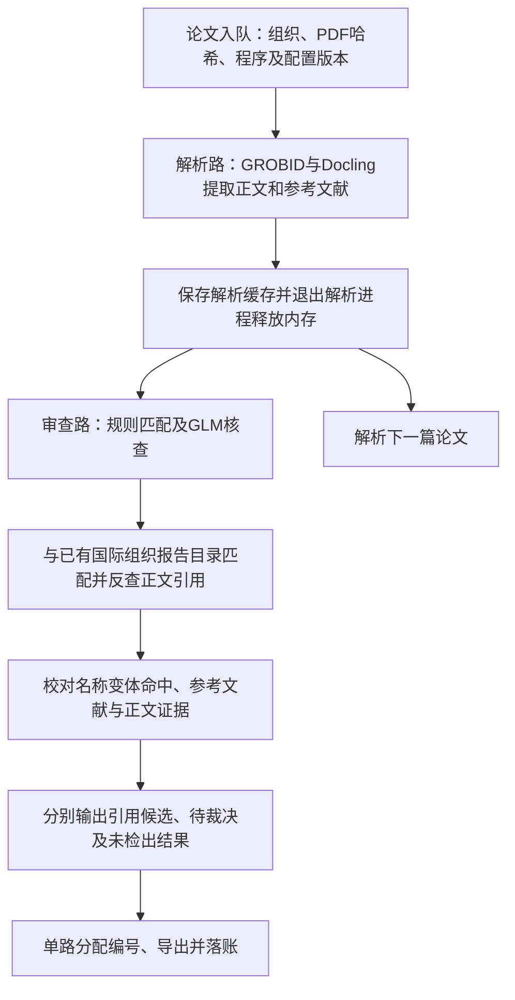
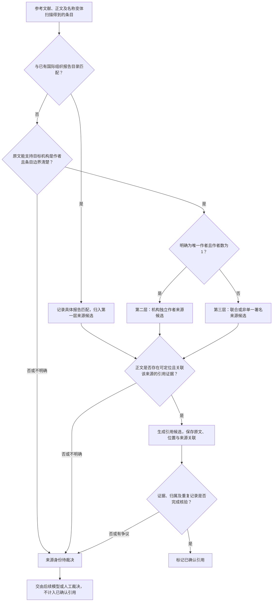
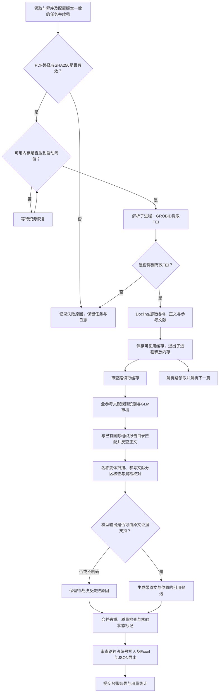

# 0.9.0.dev4：一边解析论文，一边用GLM检查引用

这次主要改了两件事：让解析和审查同时进行，减少等待；把容易漏掉的国际组织引用再检查一遍。台账也增加了进度和模型用量图，方便随时查看运行情况。

## 一眼看懂程序怎么运行

## 这次具体改了什么？

### 1. 审查这一篇时，可以继续解析下一篇

一篇论文解析完后，程序保存结果，关闭这一篇的解析进程并释放它占用的内存。GLM开始审查时，解析程序可以继续处理下一篇。写入编号和导出结果仍按顺序进行，避免两篇论文同时修改编号。

同时修复了两个会拖慢或打断处理的问题：解析和审查互相等待编号文件，以及前一步解析失败后仍继续执行后一步。实际提速多少，还要看论文长度、服务器资源和GLM响应速度。

### 2. 多查一遍容易漏掉的引用

程序会检查参考文献中的国际组织名称及不同写法，与已有国际组织报告目录匹配，并回到正文寻找对应的引用位置。GLM参与审查，帮助发现规则检查遗漏的条目；模型给出的结果仍要有论文原文支持。

遇到联合署名、机构身份不清楚或证据不足的情况，先标成“待裁决”，保留原文和位置，供后续模型或人工判断。

**匹配到一份报告，不等于已经确认正文引用了它。程序没有检出引用，也不等于这篇论文确实没有引用。**

### 3. 台账能直接看进度和模型用量

增加最近一小时的论文处理完成数量曲线，以及GLM输入、输出token用量曲线。页面约每10秒刷新一次，可以看出程序是否还在推进、模型是否正在工作。处理失败时，也会保留原因和日志，方便排查。

### 4. 支持GLM-5.3-Flash，并补齐模板

增加GLM-5.3-Flash的调用支持和配置示例。已有模型设置会保留，使用时按需选择模型。

本版附带UNEP空白采集表、名称变体、字段映射和已有报告目录。模板更新了编号规则和填写说明，正式采集区为空白，示例页的数据是虚构的。

## 程序是怎么工作的？

下面直接放出三张图：先看简化图了解整体过程，再看引用判定图了解收录规则，最后是完整程序图。

### 简化流程图

看主线：论文解析完成后，审查这一篇，同时开始解析下一篇。

### 引用判定逻辑图

看判断条件：是否匹配已有报告、机构是否为作者、正文是否有可定位的引用证据。无法判断的记录保留待裁决。图中的“已确认引用”需要完成核验，不能仅凭程序运行成功来标记。

### 完整程序流程图

看执行细节：检查文件和内存、解析、GLM审查、校对、分配编号、导出并记入台账。

## 下载哪个文件？

在本页下方的 **Assets（下载文件）** 中选择：

| 你的用途 | 下载文件 |
| --- | --- |
| 在Mac上安装 | `Tracking-Citation-0.9.0.dev4-macOS.zip` |
| 在Windows上安装 | `Tracking-Citation-0.9.0.dev4-Windows.zip` |
| 只需要采集模板及配套配置 | `Tracking-Citation-0.9.0.dev4-templates.zip` |
| 已有Python环境，自己安装程序 | `.whl` 文件 |
| 查看或修改程序源码 | `.tar.gz` 文件 |

`SHA256SUMS.txt`用于检查下载文件是否完整。

安装前需要Python（建议3.12）和GROBID解析服务，安装过程中需要联网下载依赖。解压安装包后，运行对应的安装脚本即可。详细步骤见[安装说明](https://github.com/Hugh-FanSu/Tracking-Citation/blob/main/docs/platform-releases.md)。

## 老用户怎么更新？

先让正在处理的论文完成，退出程序，再运行新版安装脚本。继续使用原来的项目编号文件，避免从头编号。新模板会放入单独的版本目录。

如果你运行的是服务器台账，还需要检查队列中任务对应的程序版本和配置，再继续处理。具体步骤见[台账升级说明](https://github.com/Hugh-FanSu/Tracking-Citation/blob/main/docs/central-ledger.md)。

## 测试情况

本版在macOS隔离环境中通过了 **337项测试**，包括两路同时工作、编号写入、台账、模型调用格式和模板检查。此次发布测试没有调用付费模型，也没有重新跑正式论文。

这是开发预发布版。Windows安装包已提供，但完整论文解析还没有在Windows实机上验证。
